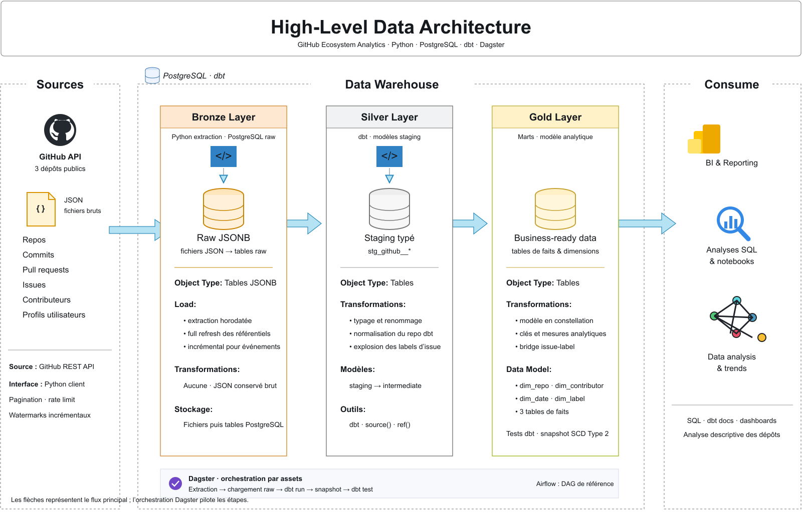
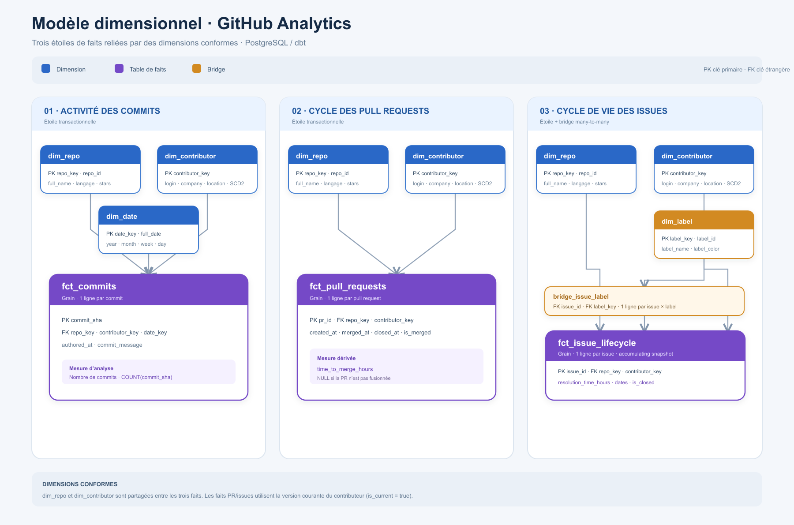

# GitHub Ecosystem Analytics

An end-to-end ELT pipeline that extracts activity data from the GitHub REST API for three major open-source data projects (`duckdb/duckdb`, `dbt-labs/dbt-core`, `apache/airflow`), models it into a star schema in PostgreSQL with dbt, and answers real questions about how these communities work.


**Stack:** Python · PostgreSQL (Docker) · dbt · Dagster · GitHub Actions · (Airflow DAG as a reference comparison)


---

## Why this project

Most pipeline demos stop at "data loaded". This one goes the full way: incremental extraction, idempotent loading, dimensional modeling with SCD Type 2, automated tests, documentation, orchestration, and analyses that produce actual findings. It is the second project of a portfolio where each project deliberately uses a different stack (the first, `weather_analytics`, uses dbt + DuckDB) to show stack-agnostic ELT skills.

---

## Architecture



| Layer | Schema | How it is built |
|---|---|---|
| Bronze | `raw` | Python extraction, incremental append, stored as `JSONB` (schema-on-read) |
| Silver | `staging` | dbt views: typing, cleaning, `nullif` for empty strings, repo name normalization |
| Gold | `marts` | dbt tables for dimensions, **incremental** models for facts; star schema, SCD2 snapshot on contributors |

### Pipeline flow

```
GitHub API ─► Python extractors ─► raw (JSONB) ─► dbt staging ─► dbt marts ─► analyses
                (incremental)      (idempotent)     (clean)     (star schema)
                                         ▲
                                  Dagster orchestrates every step
```

### Data model



- **Dimensions:** `dim_repo`, `dim_date` (2015–2026 spine), `dim_label` (64 labels), `dim_contributor` (**SCD Type 2** on `company` / `location`, with an `is_bot` flag). `dim_repo` and `dim_contributor` each contain an **unknown member** (`key = -1`).
- **Bridge:** `bridge_issue_label` (many-to-many between issues and labels)
- **Facts:**
  - All facts are incremental dbt models (`unique_key` + `is_incremental()` on `loaded_at`).
  - `fct_commits` — grain: one row per commit
  - `fct_pull_requests` — grain: one row per PR, with `time_to_merge_hours`
  - `fct_issue_lifecycle` — **accumulating snapshot**, one row per issue, with all labels aggregated into an array without breaking the grain

---

## Key engineering decisions

**Incremental extraction (watermark pattern).** Commits, PRs and issues are extracted incrementally. The watermark is `MAX(date)` already in `raw.*`. GitHub has no `since` parameter for PRs and issues, so those extractors stop as soon as they hit a row already loaded. Small, state-like tables (repos, contributors, users) are full refresh.

**Idempotent loads.** Each incremental table has a `UNIQUE` index on its natural key (`sha` for commits, `id` for PRs and issues) and loads with `ON CONFLICT DO NOTHING`. Re-running the pipeline never creates duplicates. A real bug found along the way: early non-idempotent loads duplicated rows, which led to this design.

**SCD Type 2 on contributors.** A dbt snapshot (`strategy=check` on `company`, `location`) feeds `dim_contributor`. Facts join on `is_current` to keep a consistent contributor key.

**Orphan keys: the unknown member.** Extraction is capped to the top 300 contributors per repo, so about 23% of facts have an author that is not in `dim_contributor`. Instead of leaving NULL foreign keys (which silently drop rows in inner joins), those facts point to a `contributor_key = -1` / `'(unknown)'` row (Kimball's unknown member). Foreign keys are therefore never NULL and enforced with dbt `relationships` tests. `dim_repo` has the same member for repos that fail to match.

**Incremental facts and stable surrogate keys.** Facts are incremental (`delete+insert` on the natural key, filtered on `loaded_at`), consistent with the incremental extraction. This requires surrogate keys that never change: `row_number()` would renumber the dimension whenever a row is added and silently corrupt the keys already stored in the facts. Keys are instead a hash of the natural key (`stable_key` macro, first 60 bits of the md5 as a `bigint`). Trade-off: a fact keeps the dimension version that was current when it was loaded (correct SCD2 semantics), but a fact loaded as unknown is not re-linked if its contributor is added to the dimension later; a `dbt run --full-refresh` rebuilds the facts.

**Bots are flagged, not dropped.** `dim_contributor.is_bot` (login ending in `[bot]`) lets each analysis decide; the Pareto analysis excludes them.

**Schema-independent SQL.** All models use `ref()` / `source()` (6 raw tables declared in `_sources.yml`) instead of hardcoded `schema.table`. A custom `generate_schema_name` macro makes `models/staging/` and `models/marts/` land in their own Postgres schemas, which dbt does not do by default.

**Dagster over Airflow, by constraint.** I first tried Apache Airflow with `docker-compose`, but the default CeleryExecutor stack was too heavy for an 8 GB machine already at 94% RAM. I switched to Dagster to actually run the pipeline, and wrote the equivalent Airflow DAG as a side-by-side reference (task-based `>>` vs asset-based `deps=[]`). The DAG file was **not executed**.

### Orchestration (Dagster)

Asset graph: `extracted_{repos,commits,pull_requests,issues,contributors}` and `extracted_users` (which depends on `extracted_contributors`) all feed `raw_loaded` → `dbt_staging` → `dbt_snapshot` → `dbt_marts` → `dbt_tests_passed`.


---

## Data quality and documentation

- **33 tests, all passing:** 31 generic (`unique` / `not_null` on keys, and `relationships` on every foreign key of the three facts) and 2 custom (`assert_positive_merge_time`, `assert_positive_resolution_time`).
- **CI (GitHub Actions)** on every push: PostgreSQL service container, synthetic raw data (`dbt_project/ci/seed_raw.sql`), `sqlfluff lint`, then `dbt build` twice (the second run exercises the incremental path).
- Model and column descriptions in `_marts.yml`, served with `dbt docs`.


---

## Findings

Current volumes after incremental runs: 887 contributors, 1,145 commits, 1,346 pull requests, 274 issues.

**1. Time to merge a PR (average):** airflow **16.7 h** < dbt-core **20.8 h** < duckdb **29.9 h**.

**2. Contribution concentration (Pareto):** **63 of 884 human contributors (7.1%)** account for 80% of contributions (the 3 bots are excluded with `is_bot`; keeping them gives the same result). Computed with a cumulative `SUM() OVER` window function.

**3. Issue resolution time (average):** airflow **22.9 h** < duckdb **61.2 h** < dbt-core **150.0 h**. dbt-core also has by far the most granular label taxonomy (`area:*`, `engine:v2`, `status:triage`).

**4. Cross-repo activity over time:** not conclusive. The extraction window only covers Aug–Sep 2026, too short to show a trend (see limitations).

**Data surprises worth noting:**
- The real PR rejection rate is about **26%** (197 closed-unmerged out of 750 closed PRs), once open PRs are excluded. The naive "not merged" count is misleading.
- 13 contributors appear in the top-contributor lists of two repos (none in all three), including bots (`github-actions[bot]`, `dependabot[bot]`).
- GitHub silently renamed `dbt-labs/dbt-core` to `dbt-labs/dbt`, which broke the join to `dim_repo` until `source_repo` was normalized in staging.

---

## Known limitations

- **Contributor cap:** extraction is limited to the top 300 contributors per repo, so about **23% of fact rows point to the unknown member (`contributor_key = -1`)** (occasional contributors outside the top 300). This is a deliberate tradeoff, not a bug. Per-contributor analyses are only meaningful on the remaining 77%.
- **Short time window:** the extraction cap (5 pages of 100 items per repo) limits history: PRs start on 6 Aug 2026 and issues on 23 Aug 2026, which is why analysis 4 is inconclusive.
- **Small samples:** issue resolution stats rely on 11–32 closed issues per repo. Treat them as indicative.
- **Bots** are kept in `dim_contributor` and flagged with `is_bot`; bots outside the top 300 fall into the unknown member and cannot be flagged.
- **Airflow DAG** is a reference artifact and has not been run.

---

## Run it

```bash
# 1. Environment
cp .env.example .env          # add GITHUB_TOKEN (classic PAT: repo, read:org)
docker compose up -d          # PostgreSQL (github_analytics, port 5432)
pip install -r requirements.txt
pip install dbt-postgres dagster dagster-webserver

# 2. Pipeline (manually) — order matters: users needs contributors
cd extraction
python extract_repos.py
python extract_contributors.py
python extract_users.py
python extract_commits.py
python extract_pull_requests.py
python extract_issues.py
python load_to_postgres.py        # add --all on an empty database to replay every extract
cd ../dbt_project && dbt build   # staging, snapshot, marts and tests in dependency order

# 3. Or orchestrated
cd dagster_project && dagster dev -m github_ecosystem_dagster.definitions    # http://localhost:3000

# 4. Docs
cd dbt_project && dbt docs generate && dbt docs serve
```

dbt reads its connection from a profile named `dbt_project` in `~/.dbt/profiles.yml` (Postgres, same host/port/database/user as `.env`). That file is not part of the repository (CI uses `dbt_project/ci/profiles.yml`).

The four analyses live in `dbt_project/analyses/`. After `dbt compile`, run e.g. `psql ... -f target/compiled/dbt_project/analyses/pareto_contributions.sql`.

After changing a fact model, rebuild it with `dbt run --full-refresh`.

---

## Repository structure

```
.
├── .env.example
├── docker-compose.yml          # PostgreSQL
├── requirements.txt
├── extraction/
│   ├── github_client.py
│   ├── extract_{repos,contributors,users,commits,pull_requests,issues}.py
│   └── load_to_postgres.py
├── .github/workflows/ci.yml
├── requirements-ci.txt
├── dbt_project/
│   ├── models/{staging,intermediate,marts}/
│   ├── analyses/               # the 4 analyses as SQL
│   ├── ci/                     # CI profile + synthetic raw data
│   ├── snapshots/contributors_snapshot.sql
│   ├── macros/{generate_schema_name,stable_key}.sql
│   └── tests/
├── dagster_project/github_ecosystem_dagster/   # assets.py, definitions.py
├── airflow/                    # dags/github_ecosystem_dag.py + docker-compose.yaml, reference only
└── docs/
    ├── architecture.drawio
    └── images/
```

---

## What I would do next

- Raise the extraction cap to get a real time series for analysis 4
- Add `dbt source freshness` checks and alerting on Dagster failures
- Run the Airflow + Cosmos version on a machine with enough RAM